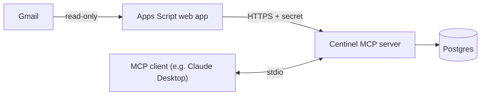

# Centinel

A personal expense tracker fed by an AI agent: it reads your payment emails and
your chat messages, registers each expense and learns how to categorize them.

## The problem

Knowing where your money goes means writing down every expense, and nobody keeps
that up for long. Most payments already leave a trace in your inbox, though: a
bank card notice, a payment app transfer, a store's order confirmation. Centinel turns
those emails, plus anything you tell it in a chat, into a categorized expense
log, and asks you only for what an email cannot say, such as what a transfer to
a person was for.

## Demo

https://github.com/user-attachments/assets/6dd0a700-ced5-4e68-86b1-bafadda15f42

## How it works

Centinel is an [MCP](https://modelcontextprotocol.io) server. An MCP client such
as Claude Desktop, Cursor or VS Code runs it locally and calls its tools: the
model does the reading and reasoning, Centinel does the bookkeeping. No LLM API
key is needed; the model is the one your client already uses.



An email becomes an expense like this:

1. You tell the agent which addresses send your receipts (`add_sender`).
2. When you ask it to check your emails, Centinel searches the last 30 days of
   those senders through a read-only Google Apps Script and records the new ones
   as pending. Only the Gmail id and a status are stored, never the content.
3. `list_pending_emails` fetches each pending email and turns it into plain text
   for the agent.
4. The agent saves it with `save_expense`, merges it with an expense already
   saved from another email of the same purchase, or marks it with
   `ignore_email` when it is not an expense.
5. For payees with no learned category, or emails that do not say what was
   bought, the agent asks you and teaches the answer back to Centinel.

## Features

- **Two inputs:** payment emails and plain chat ("I paid 25 for lunch at Bembos").
- **Categories that are learned:** a merchant learns the category of its first
  categorized expense, and its later expenses get it automatically.
- **People told apart:** when a notice names the payee only partly ("John Sm\*"
  and a masked number), the visible digits are stored as a merchant reference.
- **Duplicates merged:** the store's order confirmation and the bank's card
  notice of one purchase become a single expense.
- **Noise ignored:** ads, order status updates, money received and transfers
  between your own accounts are not counted as expenses.
- **Questions over guesses:** when the payee, amount or purpose is unclear, the
  agent asks you.
- **Corrections:** any expense can be edited later by asking the agent.
- **Spending queries:** totals computed in SQL, one per currency, filtered by
  period, category, merchant or payment method, and split by category, merchant,
  day, week or month in the user's timezone. The agent never adds up amounts.

## Design decisions

- **MCP instead of calling an LLM API.** The model comes with the client you
  already use, and the same server works with any MCP client that runs local
  servers. Centinel stays a
  plain, testable Python service that never parses natural language itself.
- **No per-store templates.** Instead of a parser per email format, the agent
  reads each email as text. A new store only needs `add_sender`, and a format
  change breaks nothing.
- **Tool inputs written for the model.** Pydantic schemas double as the JSON
  schema the model sees, with descriptions aimed at it. Service errors are
  worded so the agent can correct its next call ("Unknown category 'pets'.
  Valid categories: food, health, ...").
- **Pull, not push, and no background process.** Emails are searched when the
  agent needs them, re-searching a fixed window instead of keeping sync state.
- **Business logic apart from the transport.** `expenses/` and `emails/` know
  nothing about MCP; `mcp_server/` is a thin adapter. Gmail sits behind a
  protocol, so tests use a fake one.

## Security

- **Prompt injection:** emails are written by third parties. The agent is told
  to read them as data and never follow instructions inside them, and the only
  tool that overwrites data (`update_expense`) is marked destructive, so
  clients that honor it ask you before each call. There is no delete tool.
- **Least privilege on Gmail:** the Apps Script uses the `gmail.readonly` scope;
  it cannot send, change or delete emails.
- **Secret handling:** the Apps Script is protected by a shared secret that
  lives only in `.env`. HTTP request logging is silenced and error messages are
  scrubbed so the secret never reaches logs, with a test that guards it.
- **Minimal data:** email contents are never stored; only their ids and status.

## Tech stack

Python 3.14 · uv · MCP Python SDK · SQLAlchemy 2 · Alembic · PostgreSQL (Neon) ·
Pydantic · httpx · Google Apps Script · pytest · ruff · pyrefly

## Setup

Requirements: [uv](https://docs.astral.sh/uv/), a PostgreSQL database
([Neon](https://neon.tech) or the local one in `compose.yml`) and an MCP client
that runs local (stdio) servers. Tested with
[Claude Desktop](https://claude.ai/download).

1. Clone the repository and install the dependencies:

   ```sh
   git clone https://github.com/Alex-Huaracha/centinel.git
   cd centinel
   uv sync
   ```

2. Copy `.env.example` to `.env` and set `DATABASE_URL` and `TIMEZONE`. For
   Neon, take the connection string from its dashboard and change
   `postgresql://` to `postgresql+psycopg://`. For a local database, run
   `docker compose up -d db`. `TIMEZONE` is where you are, e.g.
   `America/Mexico_City`, not where the server runs.

3. Create the tables and the default categories:

   ```sh
   uv run alembic upgrade head
   ```

4. Optional, for email intake: deploy the Apps Script by following
   [`apps_script/README.md`](apps_script/README.md) and fill in
   `GMAIL_SCRIPT_URL` and `GMAIL_SCRIPT_SECRET`.

5. Add Centinel to your MCP client and restart it. This is the config for Claude
   Desktop (Settings → Developer → Edit config); other clients take the same
   `command` and `args` in their own config file:

   ```json
   {
     "mcpServers": {
       "centinel": {
         "command": "uv",
         "args": ["--directory", "/path/to/centinel", "run", "python", "-m", "centinel.mcp_server.server"]
       }
     }
   }
   ```

Then ask the agent something like "I spent 12 on a taxi today" or "add my bank's
notifications sender and check my emails".

## Development

Tests run against their own PostgreSQL server, the `db-test` service in
`compose.yml`, set by `TEST_DATABASE_URL`. Its data lives in memory, and each
test runs inside a transaction that is rolled back:

```sh
docker compose up -d db-test
uv run pytest
uv run ruff check . && uv run ruff format --check .
uv run pyrefly check
```
